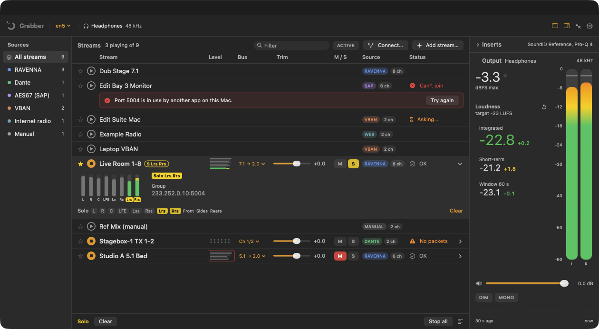
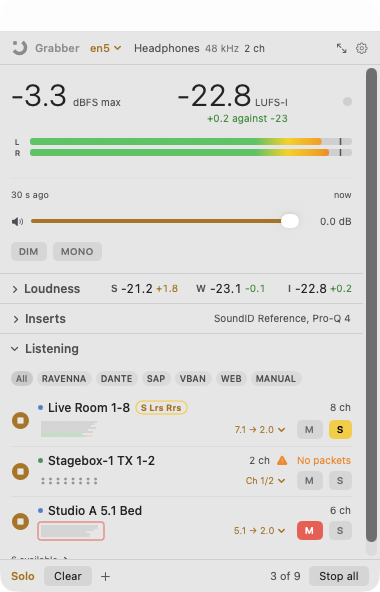
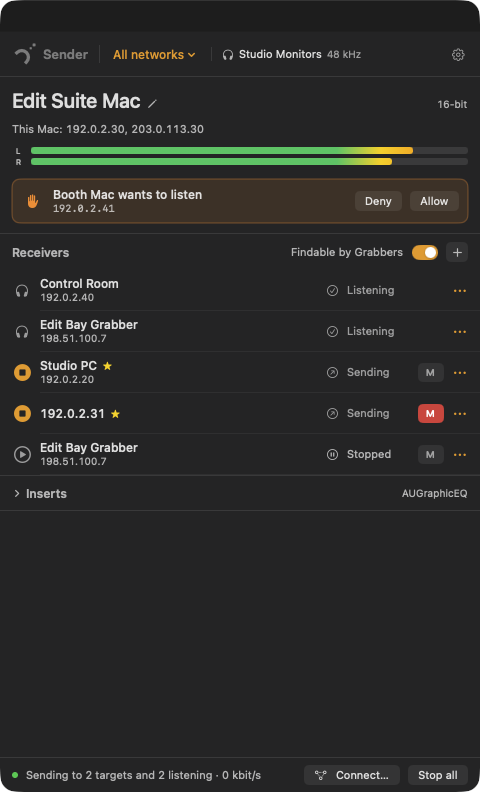

# Network Audio Grabber & Sender (NAGS)

**Hear what's on the audio network, and send a Mac's audio to it, without installing a driver.**

Free macOS apps and Audio Unit plug-ins by DAT Audio. Version 0.16.2 (beta).

**New: a Windows beta** (0.16.2) of the Grabber and the Sender, from the same engine. See
[Windows (beta)](#windows-beta).



 

- **Network Audio Grabber** listens to network audio streams on a Mac: AES67, RAVENNA, Dante in
  AES67 mode, VBAN and more, several at once, with proper metering and loudness.
- **Network Audio Sender** sends whatever a Mac is playing to other machines as VBAN, to a Grabber
  or any VBAN receiver. The Grabber has the same Sender built in, so one app can both send and
  receive.
- **DAT Audio plug-ins (Audio Unit, beta):** the Grabber and Sender inside a DAW: *Grabber*
  (instrument), *Grabber (effect)* and *Sender*.

**At a glance:**

- **Joins existing PTP-clocked streams** (AES67, RAVENNA, Dante in AES67 mode) as they are: no
  PTP daemon, virtual audio driver or configuration files. The Mac follows the stream's clock by
  resampling.
- **Multichannel:** streams of up to 64 channels (256 for VBAN), played out in stereo, 4.0, 5.1,
  7.1 or the output device's full width, with per-channel meters and solo.
- **Audio Unit inserts** on the monitor path and on what's sent, hosted out of process so a
  crashing plug-in can't stop the audio.
- **Finds each other automatically:** on the same network, a Sender switched to **Findable** shows
  up in every Grabber with nothing to set up. The Sender asks before sending to a Grabber you
  haven't allowed.
- **Across networks:** outside the local network, two ends connect with a code exchange that sets
  up an **encrypted** Remote link, with no router or VPN set-up.

## What it does

**Receiving (Grabber)**

- Finds streams by itself (SAP, RAVENNA, Dante devices and VBAN) and merges them into one list.
  Paste an SDP for anything that isn't announced.
- Plays several streams at once, each with trim, mute, solo, per-channel solo, fold-down and
  channel-order handling (SMPTE and others).
- Plays to the Mac's default output or a chosen device, in stereo, 4.0, 5.1, 7.1 or the device's
  full width.
- Per-channel and master metering with peak hold, clip and level history.
- Loudness to ITU-R BS.1770-4 / EBU R 128: short-term, a chosen window and integrated, with
  targets.
- Three Audio Unit insert slots on the monitor path, hosted out of process, so a crashing plug-in
  can't take the audio down. It's reloaded automatically.
- Diagnostics in plain words: loss, jitter, drift, underruns, buffer budget, and why a join failed.
- A full window and a compact one to leave on screen; light and dark, colour schemes and DAW-style
  skins.

**Sending (Sender, or the Grabber's own Send area)**

- Sends this Mac's whole output (macOS 14.2+), chosen apps, or one input device, as VBAN, 16- or
  24-bit, in stereo or at the output device's full channel count.
- Four ways to reach a receiver, each chosen by you; nothing sends at launch:
  1. **Findable:** Grabbers on the network list the stream, and it's only sent to those you
     **Allow**.
  2. **Broadcast** to the whole network (for example to Voicemeeter).
  3. **By address:** any VBAN receiver.
  4. **Remote link:** two places across the internet, with no router set-up, **encrypted end to
     end**.

**In a DAW**

- The Grabber plug-ins put a network stream on a track. The effect version is for hosts that only
  load effects (Audacity, Audition, Premiere, Final Cut, Resolve, Audio Hijack).
- The Sender plug-in sends its track over VBAN.

## Supported streams

| Kind | Found by | Formats | Default |
|---|---|---|---|
| **AES67** | SAP | L16, L24, L32; 1–64 ch; 8–384 kHz (resampled to the device) | On |
| **RAVENNA** | Bonjour + RTSP | as AES67 | On |
| **Dante** (AES67 mode) | Bonjour | as AES67 | On |
| **VBAN** receive | UDP 6980; Senders offer themselves | PCM 16/24/32-bit int, 32/64-bit float, up to 256 ch | On |
| **VBAN** send | Findable, broadcast, address, Remote link | PCM 16/24-bit, stereo or multichannel | Off until chosen |
| **Scream** | UDP 4010 / 239.255.77.77 | PCM 16/24/32-bit | Beta, off |
| **RTP without PTP** (PipeWire, PulseAudio, VLC, GStreamer) | SAP or pasted SDP | L16/L24 | Beta, off |
| **Internet radio** (Icecast, SHOUTcast, HTTP) | Added by URL | MP3, AAC, FLAC | Beta, off |

**Not supported:** native Dante audio (only Dante's AES67 mode); Dante Virtual Soundcard and Dante
Via as senders; PTP-locked playback; ST 2022-7 dual-network receive; IPv6; encrypted SAP; VBAN's
compressed codecs; AES67 across a remote-access VPN.

## Requirements

- **macOS 14.2 (Sonoma) or later** on **Apple silicon**.
- For sending: the **System Audio Recording** permission, which is asked for when you first send.
- For discovery: the **Local Network** permission.

## Install

1. Download **`NAGS-Mac-0.16.2.dmg`** from the [Releases](../../releases) page, open
   it, and drag the apps to **Applications**.
2. **First open:** the apps are self-signed, not notarised by Apple, so macOS asks once.
   - macOS 15 or later: open the app, click **Done**, then go to **System Settings → Privacy &
     Security** and click **Open Anyway**.
   - macOS 14: Control-click the app, choose **Open**, then **Open**.
3. Allow **Local Network** when asked, and **System Audio Recording** when you first send.
4. **Plug-ins (beta):** in the Grabber, choose **Help → Install DAW Plug-ins…**. No password or
   Terminal is needed. To install them for all users, drag *DAT Audio Plug-ins* onto *Components*
   in the disk image instead; this needs your password, and then
   `sudo xattr -dr com.apple.quarantine` on the installed plug-in, because a DAW can't show
   "Open Anyway".

The illustrated [Quick Start Guide](docs/quick-start/QUICK-START.md) is also in each app, under
**Help → Quick Start Guide**. The full manual is [docs/GUIDE.md](docs/GUIDE.md).

**Uninstall:** **Settings → Remove all settings…** in either app, **Help → Remove DAW Plug-ins…**
in the Grabber, then move the apps to the Bin.

## Windows (beta)

**`NAGS-Windows-0.16.2.zip`** holds the Windows Grabber and Sender, built from the same
engine as the Mac apps, so a stream from a Mac and one from a PC are the same stream and each plays
on the other. For 64-bit Windows 10 or 11 with the Microsoft Visual C++ runtime, which nearly
every PC has. A beta, for trying: it has been tested on one PC so far.

- **Network Audio Grabber** (`nag-grabber.exe`): the Mac Grabber's window, layout and wording,
  with VST3 inserts, a choice of output device, and RAVENNA and Dante found over Windows' own
  Bonjour. Surround buses go out labelled, so Windows Sonic and Dolby Atmos for Headphones place
  them around your head.
- **Network Audio Sender** (`nag-sender.exe`): sends this PC's audio as VBAN, the same four
  ways as on the Mac.
- `nag-grab.exe` and `nag-send.exe` are the same two without a window, for a terminal.

**Install:** unzip the whole folder somewhere that isn't synced (not Dropbox or OneDrive), keep the
files together, and open `nag-grabber.exe`. When Windows Defender Firewall asks, tick **Private
networks** and choose **Allow access**. The programs aren't signed, so SmartScreen may warn: choose
**More info → Run anyway**. `README.txt` in the folder covers the rest, and what's new in each
beta. Not on Windows yet: internet radio and the plug-ins.

## Some uses

- Checking what's on an AES67, RAVENNA or Dante network from a Mac, without a virtual sound card.
- Monitoring several feeds at once on headphones, with solo and per-channel listening.
- Loudness checks on a broadcast or delivery bus against EBU R 128 targets.
- Room correction or EQ on the monitor feed with an Audio Unit insert.
- Listening to another Mac in the next room: Findable on the Sender, one click on the Grabber.
- Remote review between two places with the encrypted Remote link, without IT or router changes.
- Windows into the Mac (Voicemeeter or Scream), or the Mac into Windows (Voicemeeter, VBAN
  Receptor).
- A DAW as the hub: record a network stream on a track, or send a mix to someone's headphones.

## Privacy and security

- No accounts, telemetry, analytics or update checks. The apps make no internet requests of their
  own. **Find this network's outside address** asks a public STUN server (Cloudflare's), but only
  when you press it. The Remote link talks only to the other end.
- Nothing is captured or sent until you choose to. The audio-recording permission is asked for
  only when sending starts.
- Local-network audio (VBAN, AES67) is unencrypted, as in every tool of this kind. Each stream is
  marked LOCAL, VPN or REMOTE, and ENCRYPTED or NOT ENCRYPTED.
- **Findable** only sends to an address that asked and was allowed. Replies are never larger
  than requests, requests are rate-limited, and there are at most eight listeners.
- The Remote link uses keys derived with HKDF-SHA256 and seals every packet with
  ChaCha20-Poly1305, with a replay window. Codes expire after about 15 minutes.

## Limitations

- It's for monitoring, not a PTP-locked device. The Mac resamples by a few ppm to stay in step.
- Multicast needs the network to deliver it: the right interface, an IGMP querier, the same VLAN.
  Wi-Fi is usually on a different subnet.
- Multichannel output is pass-through: there's no routing matrix and no 7.1-to-5.1 fold.
- If the app and a Grabber plug-in run at the same time, they share VBAN's port. Direct
  (non-offered) VBAN reaches whichever started first.
- In Logic, a Software Instrument track renders only while it's selected or armed.
- Insert plug-ins are Audio Units only.
- **Beta:** VBAN receive, the Sender and the plug-ins have been tested on a small number of Macs
  so far, the plug-ins mainly in REAPER. The AES67, RAVENNA and Dante receive path is the mature
  part.

## Alongside, not instead

NAGS doesn't replace the established network-audio tools; it sits next to them. It covers the
moments between: hearing a stream without installing a driver, checking what's on a network from
any Mac, or sending a mix to the next room.

| Tool | What it's for | With NAGS | Where NAGS fits |
|---|---|---|---|
| **Dante Controller** (free) | Dante routing and clock diagnostics | Use together | Use it to switch a device to AES67 mode. The Grabber can then listen to it. |
| **Dante Virtual Soundcard, Dante Via** (paid) | Native Dante audio on a computer | Different job | They do native Dante, which NAGS doesn't. NAGS listens without a licence or driver, but only to AES67, and they can't send AES67 for it to hear. |
| **Merging MAD, ANEMAN** (free) | RAVENNA/AES67 driver and connection management | Use together | The Grabber receives the RAVENNA/AES67 streams a Merging MAD machine sends: for example a Windows PC running MAD, heard on a Mac with nothing installed. This is in regular use. Keep MAD and ANEMAN for routing and recording. |
| **RAV2SAP** (free) | Announces RAVENNA streams over SAP, and SDP editing | Use together | Management, not monitoring. The Grabber finds RAVENNA streams directly, and also hears any it announces. |
| **VB-Audio Voicemeeter, VBAN Receptor** | VBAN on Windows and phones | Use together | Fully compatible both ways. NAGS adds discovery, ask-first sending and an encrypted Remote link on the Mac. |
| **Rogue Amoeba Loopback, Audio Hijack, SoundSource** (paid) | Audio routing and recording on the Mac | Use together | Not network tools, so they pair well. The Grabber's effect plug-in runs inside Audio Hijack. |
| **AES67 Stream Monitor** (free, MIT) | AES67 receive, one channel pair at a time | Different job | The closest free equivalent. The Grabber plays several streams and all their channels, finds RAVENNA and Dante directly, and adds VBAN and loudness. |
| **Lawo RƎLAY AoIP Stream Monitor** (paid, Windows) | Professional stream monitoring with alarms and dual-network receive | Different job | The professional benchmark. The Grabber is lighter and on the Mac, with no alarms or dual-network receive. |
| **SonoBus** (free, open source) | Peer-to-peer internet audio between people | Different job | Built for real-time collaboration, with its own protocol. The Remote link is for monitoring between these apps, and NAGS is VBAN-compatible on the local network. |
| **Audiomovers LISTENTO, Source-Connect** (paid) | Commercial remote listening and contribution | Different job | Compressed, with accounts and subscriptions. The Remote link is uncompressed PCM, free and direct between two Macs, with no account. |
| **A VPN** (Tailscale and others) | Makes two places one network | Use together | VBAN and the Sender work across it (the apps label it VPN), but AES67 multicast doesn't. The Remote link does the same job with nothing to install. |

**What NAGS adds among free tools:** one list for AES67, RAVENNA, Dante (AES67), VBAN, Scream,
plain RTP and internet radio; several streams mixed with per-stream trim, fold-down and channel
solo; EBU R 128 loudness; out-of-process Audio Unit inserts; a companion Sender with consent and an
encrypted Remote link; and the same in a DAW as plug-ins.

Compared against each vendor's own pages in September 2026. Other names and trademarks belong to
their owners.

## Building from source

Needs macOS 14.2+, and Xcode or its Command Line Tools with Swift 5.9 or later.

```sh
./build.sh                 # both apps and the plug-ins, release, into build/
./build.sh release dmg     # the same, plus the disk image
```

The only external dependency is Apple's [swift-crypto](https://github.com/apple/swift-crypto),
which Swift Package Manager fetches on the first build.

Builds are ad-hoc signed unless a code-signing identity called *Network Audio Local Signing* is
in your keychain. Use any name with `SIGN_IDENTITY="…" ./build.sh`. A stable identity keeps
macOS's audio-recording permission across rebuilds; see *A stable signature for development* in
the [guide](docs/GUIDE.md).

**Windows:** on a PC with the Swift toolchain for Windows, from PowerShell:

```powershell
.\build-windows.ps1          # release build, engine check, package folder
.\build-windows.ps1 -Zip     # the same, plus the .zip
```

The build goes to `%LOCALAPPDATA%\nag-build` (`-Scratch` to change it). The Windows code is all in
`Sources/Windows`; VST3 hosting uses the hosting part of Steinberg's VST 3 SDK (MIT), included in
`Sources/Windows/NAGVST3/vst3sdk`.

Self-tests:

```sh
"build/Network Audio Grabber.app/Contents/MacOS/NetworkAudioGrabber" --checkvban
"build/Network Audio Grabber.app/Contents/MacOS/NetworkAudioGrabber" --checkdefaults
"$(swift build -c release --show-bin-path)/NetworkAudioEngineCheck"
```

The Sender ↔ Grabber wire protocol, with sample packets checked against the code, is in
[docs/PROTOCOL.md](docs/PROTOCOL.md).

## Licence, credits and trademarks

- MIT licence: see [LICENSE](LICENSE).
- Built with Apple's **swift-crypto** (Apache 2.0) and, for the plug-ins, Apple's
  **AudioUnitSDK** (Apache 2.0, in `Sources/AudioUnitSDK`); on Windows, Steinberg's **VST 3 SDK**
  (MIT, in `Sources/Windows/NAGVST3/vst3sdk`). Their licences ship inside the apps:
  see **About → Licences…**.
- The protocols are implemented from their public specifications. No code from other projects is
  included.
- The VBAN service type 0x4E, used by the Sender's offer, has been agreed with VBAN's author.
- Dante is a trademark of Audinate, RAVENNA of ALC NetworX, and VBAN and Voicemeeter of VB-Audio
  Software. This project isn't affiliated with or endorsed by any of them.
