# Quick start

**Network Audio Grabber** listens to audio streams on your network: AES67, RAVENNA, Dante (in
AES67 mode), VBAN and more. **Network Audio Sender** sends this Mac's audio to other Macs. The
Grabber can send too, from its own **Send** section.

What do you want to do?

- **Listen to a stream that's already on the network** → [Part 1](#part-1--listen-with-the-grabber)
- **Send this Mac's audio somewhere** → [Part 2](#part-2--send-this-macs-audio) (four ways; pick one)
- **Make the Grabber's window smaller, or show more detail** → [Part 3](#part-3--the-grabbers-window)
- **What the apps do with audio** (devices, sources, channels, routing) → [Good to know](#good-to-know)

The red numbers in each picture show where to look and what to click, in order.

---

## Part 1 — Listen with the Grabber

### 1. Choose the network, then press play

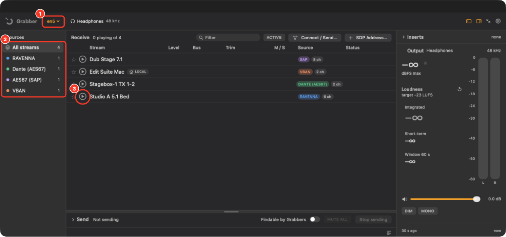

1. **Pick your audio network** from the menu at the top: the one your audio devices are
   plugged into (often a wired one).
2. **Streams appear by themselves**, a few seconds after opening. Click a source on the left to
   list only that kind.
3. **Press ▶ on a stream** to hear it.

### 2. It plays

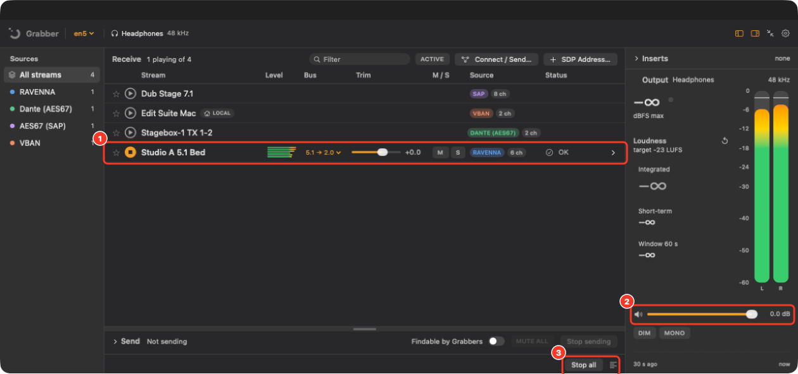

1. The row lights up, with a level meter and **OK** under Status. Press ■ to stop it.
2. **Your listening level.** It changes only what you hear, never the stream.
3. **Stop all** stops every stream at once.

That's it. The sections below are only needed if something doesn't show up or asks first.

### Stream not in the list?

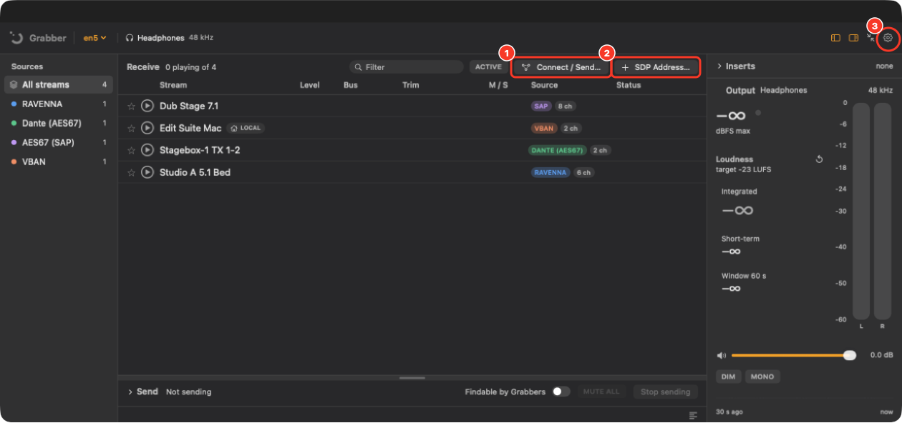

1. **Connect / Send…** opens a step-by-step guide for each kind of stream, on this network or somewhere
   else. Its steps tick themselves off as you go.
2. **SDP Address…**: for a device that doesn't announce itself, paste its SDP or address.
3. **Settings** (the gear) → **Discovery** turns kinds of stream on or off. VBAN is on to begin
   with; Scream, Internet radio and plain RTP start off.

Also check that step 1's network is the audio network, and that you allowed **Local Network**
access when macOS asked (System Settings → Privacy & Security → Local Network).

### A stream from another Mac may ask first

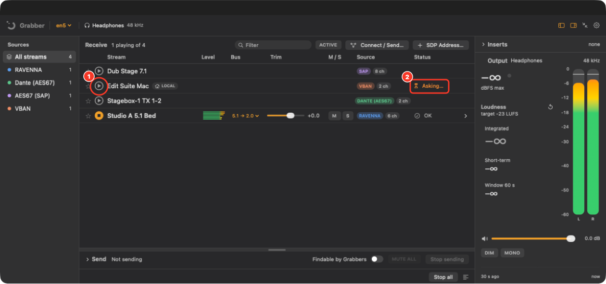

1. A stream sent with **Findable by Grabbers** ([Part 2, way A](#way-a--findable-by-grabbers))…
2. …may say **Asking…** when you press ▶. It starts by itself once the person at the other Mac
   presses **Allow**.

---

## Part 2 — Send this Mac's audio

### Where the send controls are

You can send from either app. Both have the same controls.

**In Network Audio Sender** (sends everything this Mac plays):

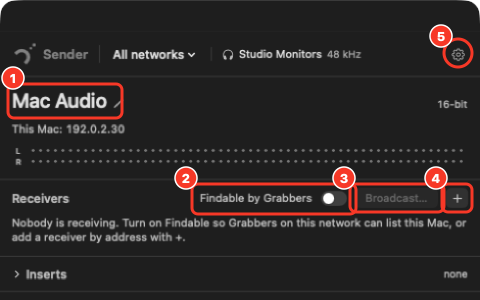

1. Your stream's name, as other Macs will see it. Click ✎ to change it.
2. **Findable by Grabbers**: [way A](#way-a--findable-by-grabbers)
3. **Broadcast…**: [way B](#way-b--broadcast-to-everyone)
4. **+**: [way C](#way-c--send-to-one-receiver-by-address)
5. **Settings** (the gear)

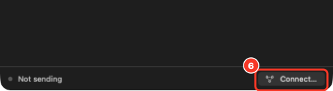

6. **Connect…**, bottom right: the Sender's step-by-step guide, including
   [way D](#way-d--another-building-remote-link).

**In the Grabber** (its **Send** section, for when the Grabber is already open):

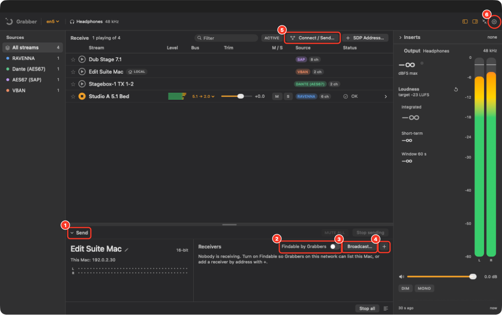

1. Open **Send** at the bottom of the Grabber's window.
2. **Findable by Grabbers**: [way A](#way-a--findable-by-grabbers)
3. **Broadcast…**: [way B](#way-b--broadcast-to-everyone)
4. **+**: [way C](#way-c--send-to-one-receiver-by-address)
5. **Connect / Send…**, at the top of the stream list (not at the bottom as in the Sender): the
   same guide as in [Part 1](#stream-not-in-the-list), on its **Send** tab. It includes [way D](#way-d--another-building-remote-link).
6. **Settings** (the gear) → **Send**

The Grabber's Send never sends what the Grabber itself is playing, so nothing loops back.

### Which way?

| Way | Best for | Sending Mac asks first? |
|---|---|---|
| **A. Findable by Grabbers** | Another Mac with the Grabber, on this network. The usual choice. | Yes, once per Grabber |
| **B. Broadcast…** | Everyone on a wired network at once | No |
| **C. + (by address)** | Voicemeeter, VBAN apps, or one particular receiver | No |
| **D. Remote link** | A Grabber in another building (home ↔ work), encrypted | No: you swap codes instead |

### Way A — Findable by Grabbers

It takes both Macs. On the **sending** Mac, turn on **Findable by Grabbers**. On the **other**
Mac, the stream appears in the Grabber's list: press ▶ there
([Part 1](#1-choose-the-network-then-press-play)). Then, back on the sending Mac:

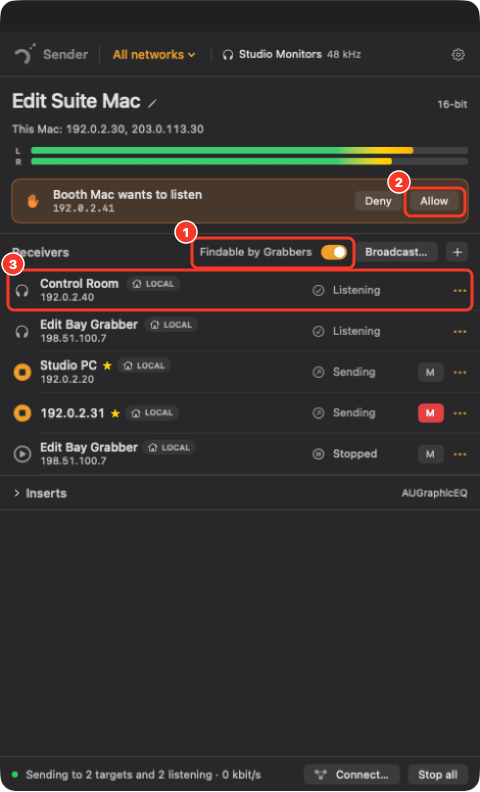

1. **Findable by Grabbers** is on.
2. A request appears: press **Allow**. That Grabber is remembered, so it won't ask again.
3. The Grabber now shows under **Receivers** as **Listening**.

**Pressed Deny by mistake?** Allow it again from Settings, without reopening anything:

- in **Network Audio Sender**: the gear → **Grabbers** → **Allow**

  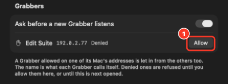

- in the **Grabber**, if you send from there: **Settings** (1) → **Send** (2) → **Grabbers** →
  **Allow** (3)

  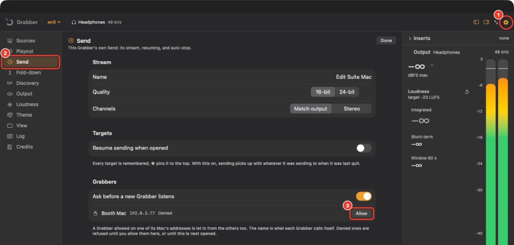

### Way B — Broadcast to everyone

Press **Broadcast…**:

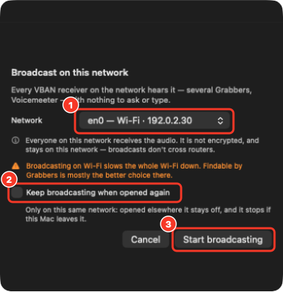

1. Choose the network.
2. Tick this to start broadcasting again whenever the app opens on this same network.
3. **Start broadcasting.** It joins the list of receivers; stop it from there.

Everyone on that network can hear it, and it isn't encrypted. On Wi-Fi it slows the whole
Wi-Fi down, so way A is mostly the better choice there.

### Way C — Send to one receiver by address

Press **+**, type the receiver's IP address (and its port, if it isn't 6980), and press
**Add**. It receives whether or not it asks, so add only receivers you mean to send to.

### Way D — Another building (Remote link)

Each end makes a code and sends it to the other end, by message or email. There's nothing to
set up on either router. Codes last about 15 minutes, so swap them while both people are there.

**At the sending end:** **Connect…** (Sender) or **Connect / Send…** (Grabber):

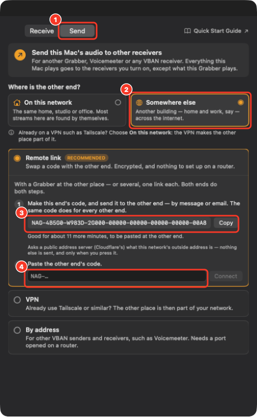

1. **Send** tab (in the Grabber; the Sender's guide has no tabs).
2. **Somewhere else.**
3. **Make this end's code**, then **Copy**, and send it to the other end.
4. Paste **their** code, then **Connect**.

**At the receiving end:** the Grabber's **Connect / Send…**:

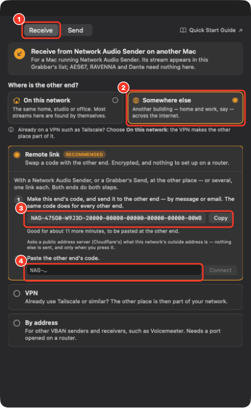

1. **Receive** tab.
2. **Somewhere else.**
3. **Make this end's code**, then **Copy**, and send it to the other end.
4. Paste **their** code, then **Connect**.

Once both codes are in, the stream appears in the receiving Grabber's list marked
**REMOTE · ENCRYPTED**. Press ▶. The link is encrypted end to end: only the two ends that swapped
codes can hear it. If both Macs already use a VPN such as Tailscale, use way A instead: the VPN
counts as this network.

---

## Part 3 — The Grabber's window

### Smaller: the compact window

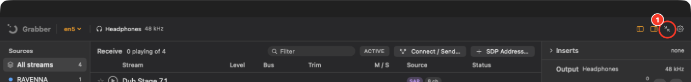

1. This button, top right, switches to the compact window. Or use **Monitor → Compact Window**
   in the menu bar (⌥⌘C).

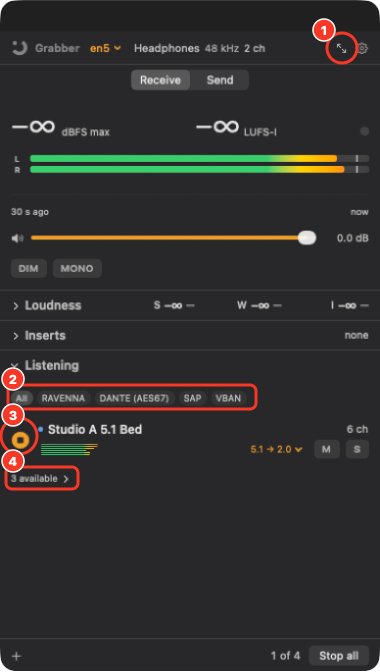

1. Back to the full window.
2. List only one kind of stream.
3. ▶ / ■ to play and stop.
4. **available** opens every stream you aren't playing yet.

Each window remembers its own size.

### More detail: Simple or Detailed

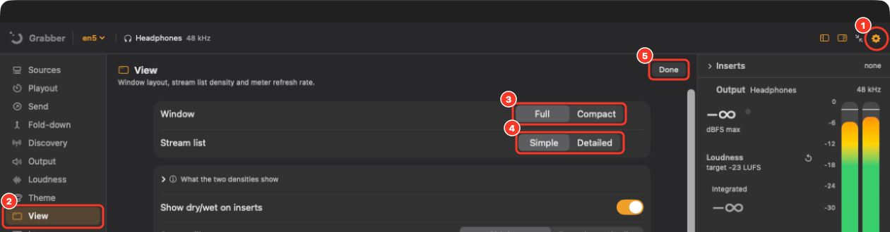

1. **Settings** (the gear).
2. **View.**
3. **Window**: Full or Compact (the same as the button above).
4. **Stream list**: **Detailed** adds each stream's arrival figures (jitter, buffer, drift, lost
   packets) to the list. In the compact window it also shows where each stream comes from.
5. **Done** goes back to the streams.

---

## Good to know

**Where the sound goes.** The Grabber plays through the Mac's current output device, and follows
it if you change it — unless you choose one: click the device name at the top of the window (or
**Settings → Output → Device**). A chosen device stays chosen whatever the Mac's own setting does;
if it's unplugged, the Grabber plays on the current one until it's back.

**Channels.** A stream can have up to 64 channels. The Grabber plays in **stereo** to begin with:
each playing stream's **Bus** menu says how it reaches stereo — a **fold-down** of the whole
stream (5.1 → 2.0, say), one **pair** of its channels, or one channel in **mono**. For a
surround setup, **Settings → Output → Output bus** can be 4.0, 5.1, 7.1 or the device's full
width, and a stream that fits then plays channel for channel. **Settings → Fold-down** sets how
the fold-down mixes the surround channels.

**What gets sent.** The Sender (and the Grabber's Send) sends **system audio** to begin with:
everything this Mac plays, except the two apps themselves. The **Source** menu (the Sender's
header; under the stream name in the Grabber's Send; or Settings) changes that to:

- **Chosen apps** — tick the apps to send; only their sound goes. A browser plays its sound from
  helper processes, and those are included with it. Ticked apps are remembered and picked up
  whenever they run.
- **An input device** — a microphone, an audio interface's inputs, or a virtual device such as
  BlackHole — sent whole, at its own channel count. macOS asks for **Microphone** access the
  first time.

System audio and apps go as stereo or with as many channels as the output device has
(Settings → **Channels**).

**Routing ideas.** macOS and a couple of free or paid tools cover setups the apps don't do by
themselves (yet):

- **Play to several devices at once:** make a **Multi-Output Device** in Audio MIDI Setup
  (Applications → Utilities; *Play on several devices…* in the device menu opens it), then choose
  it as the Grabber's output.
- **Into another app** (a DAW, a call, a recorder): choose a virtual device such as **BlackHole**
  (free) as the Grabber's output, and choose BlackHole as that app's input.
- **Send a mix of several things:** route them into BlackHole, or combine devices in an
  **aggregate device** (Audio MIDI Setup), then choose it as the Sender's input device.
- **Rogue Amoeba's Loopback** (paid) builds the same kinds of virtual devices with a visual
  router, if you'd rather not use Audio MIDI Setup.

Several outputs at once inside the Grabber, with their own inserts, is planned for a later
version.
